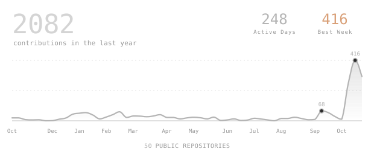

I'm **Jee**, a developer from the Philippines. I build web applications with React and TypeScript, work with Python and Java, and spend time implementing data structures and algorithms from scratch.

 

**[Grocery Tracker](https://github.com/Aicyraa/Grocery-Tracker)** &nbsp; React · TypeScript · Gemini 
An installable grocery budget tracker with spending charts and an AI assistant. 
[Live demo ↗](https://groceryio.netlify.app/)

 

**[Student Discipline Office](https://github.com/Aicyraa/SDO)** &nbsp; React · TypeScript · PWA 
Student case management, sanctions, appointments, and notifications. 
[Live application ↗](https://sdo-ten.vercel.app/)

 

**[Data Structures](https://github.com/Aicyraa/Data-Structures)** &nbsp; JavaScript 
Popular data structures implemented from scratch. 
Also: [Python DSA](https://github.com/Aicyraa/Python_DSA) · [Algorithms](https://github.com/Aicyraa/Algorithms)

 

Refreshed daily · [About these stats](./PROFILE.md)

